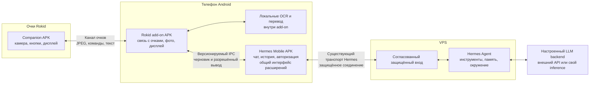
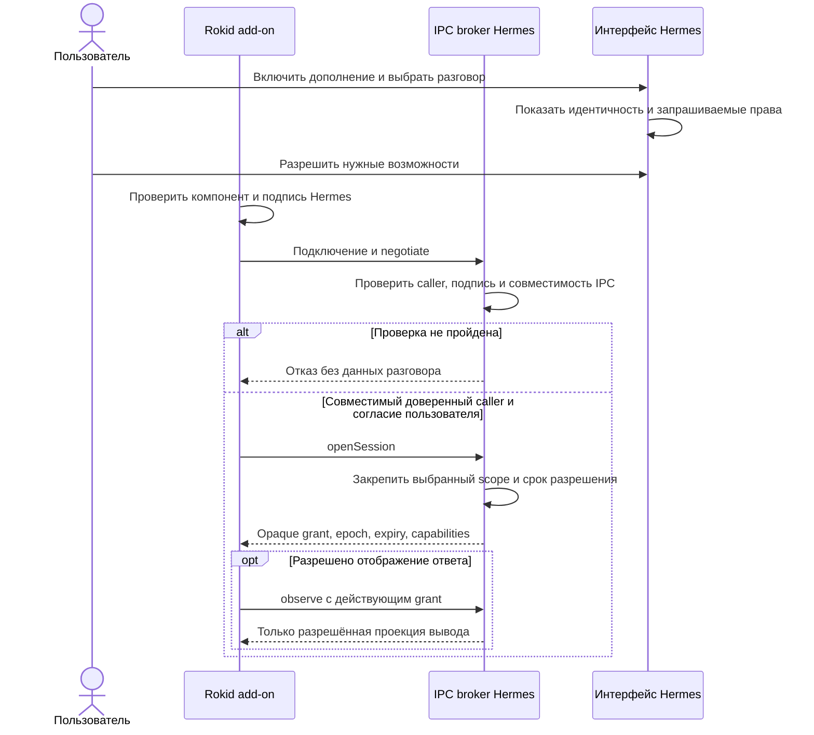
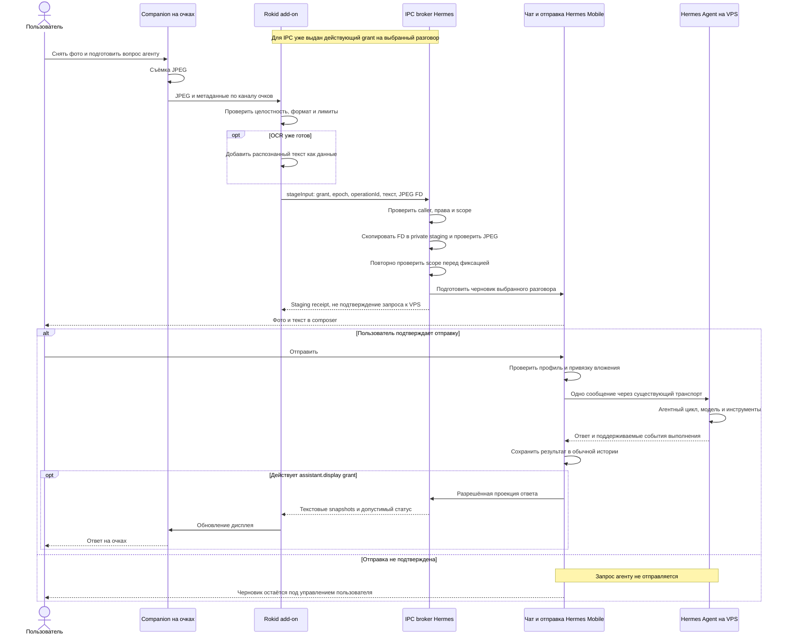
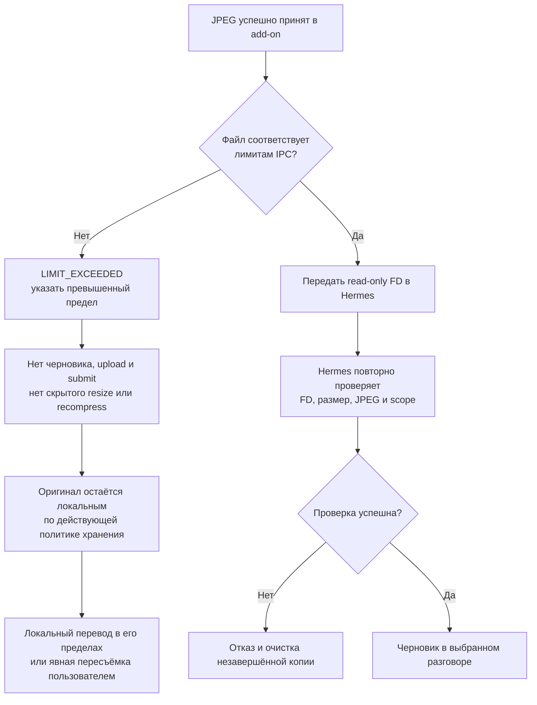
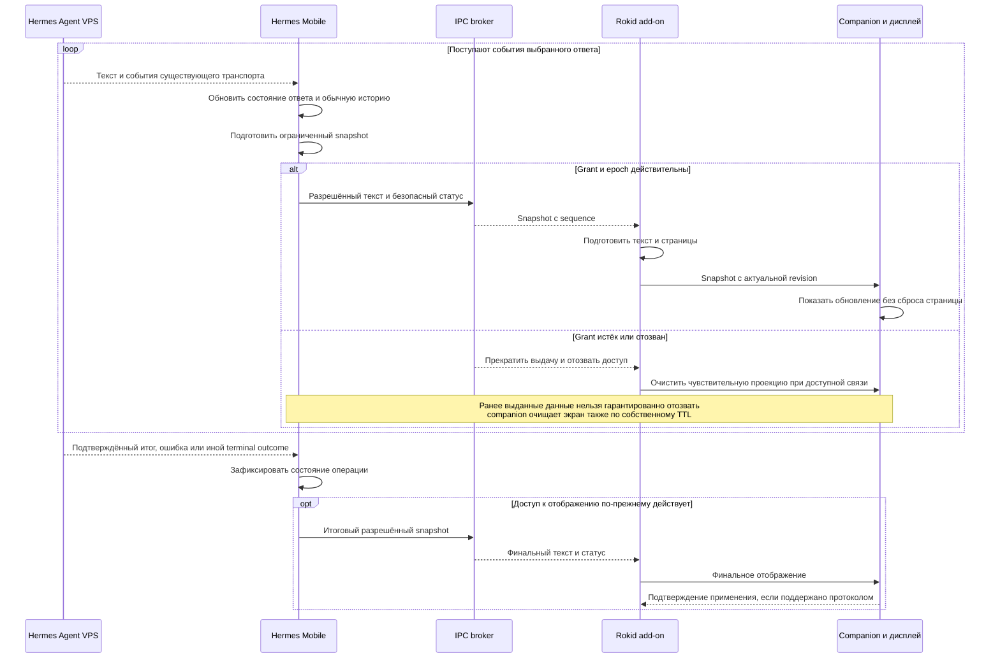
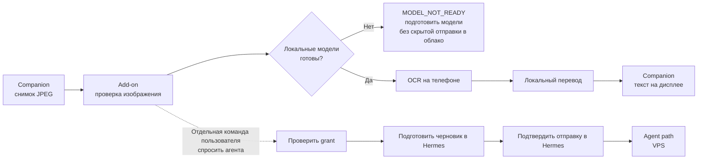
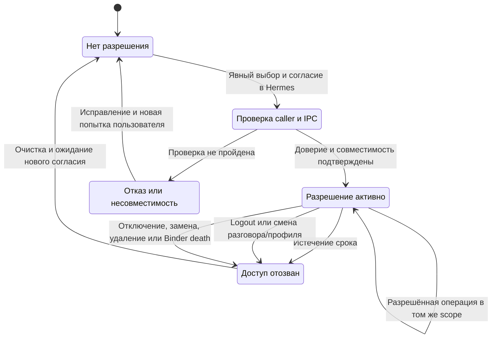
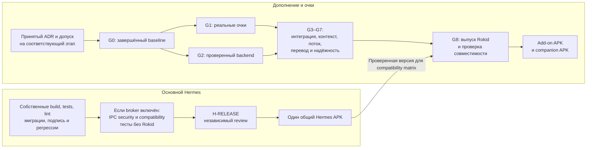

# Hermes Mobile + Rokid: архитектура и потоки запросов

> **Статус: целевой дизайн, не реализованная интеграция.**<br/>
> Основа: документация проекта на коммите `706a5c96` и уточнения владельца.<br/>
> ADR-003 — `PROPOSED`; исторический G0 — `BLOCKED`; H-RELEASE — `NOT_RUN`.<br/>
> Этот файл объясняет взаимодействие компонентов. Он не принимает ADR, не закрывает гейты и не разрешает установку APK, изменение VPS или функциональную реализацию.

Навигация: [план интеграции](../README.md) · [актуальный статус](../STATUS.md) · [текущая редакция ADR-003](../adr/ADR-003-OPTIONAL-ANDROID-ADDON.md).

Дата подготовки: **28 октября 2026 года**. Актуальность статусов ограничена указанным коммитом; источники — [ADR-003][adr] и [STATUS][status].

Схемы записаны в Mermaid и находятся непосредственно в этом файле. Отдельные изображения не нужны. В редакторе без рендеринга Mermaid остаются читаемые исходники схем и пояснения к ним.

---

## 1. Главная идея

**Очки — дополнительное устройство ввода и вывода выбранного разговора Hermes, а не самостоятельный AI-клиент.**

Полная цепочка:

```text
ОЧКИ                         ТЕЛЕФОН                                  VPS

Companion APK  <-->  Rokid add-on APK  <-->  Hermes Mobile APK  <-->  Hermes Agent
камера/дисплей       связь с очками          чат/история/auth         агент/tools
                    OCR/перевод             серверный транспорт     память/окружение
```

На телефоне устанавливаются **два отдельных APK**, на очках — ещё один. У друга без очков остаётся только обычный Hermes Mobile. Специальной «Rokid-версии» основного APK не создаём.

| Компонент | За что отвечает | Чего в нём не должно быть |
|---|---|---|
| **Hermes Mobile** | Чат, история, авторизация, существующая отправка сообщений, вложения, разрешения для дополнений и небольшой общий IPC-интерфейс | Rokid SDK, очковый Bluetooth-протокол, CXR-зависимости, разрешения и модели, нужные только дополнению |
| **Rokid add-on на телефоне** | Подключение очков, передача фото, настройки дисплея, локальные OCR/перевод, вывод разрешённого текста | Второй чат, копия истории Hermes, серверные токены, отдельное подключение к VPS или LLM |
| **Companion на очках** | Камера, кнопки, дисплей и обмен с дополнением | Учётная запись Hermes, серверные секреты, агентный цикл, постоянная история чата |
| **Hermes Agent на VPS** | Агентный цикл, инструменты, окружение и серверное состояние | Знание о Bluetooth и необходимости отдельного «Rokid-чата» |

Модели не обязательно размещаются на самом VPS: агент может использовать настроенный внешний API или отдельный inference-сервер. Это не меняет цепочку Android-клиента.

Основание: [архитектура][architecture], [границы ответственности в ADR-003][adr].

### Схема 1. Компоненты и границы



**Важные оговорки к схеме:**

- Канал очки–телефон подтверждается на G1. Для donor-пути рассматривается Bluetooth SPP; CXR — альтернативный путь интеграции, а не автоматически обязательный второй канал. Совместимость конкретной прошивки и условия использования зависимостей ещё требуют проверки.
- Клиент–VPS использует один проверенный транспорт разговора. Возможности установленного сервера подтверждаются на G2. Отдельный OpenAI-compatible клиент внутри add-on не создаётся.
- Общий Hermes Agent не означает автоматически общую историю Telegram и Android. Этот документ описывает один выбранный разговор **в Hermes Mobile**.

См. [G1/G2][gates] и [выбор серверного транспорта][architecture].

---

## 2. Первое подключение и выбор разговора

Установка дополнения сама по себе не даёт ему доступ к разговорам. В Hermes пользователь явно выбирает разговор и права:

| Право | Что разрешает | Что не разрешает |
|---|---|---|
| `draft.write` | Подготовить черновик текста/фото в разрешённом разговоре | Отправить запрос без подтверждения |
| `assistant.display` | Получать ограниченный вывод разрешённого ответа для очков | Читать всю историю, другие разговоры или скрытые служебные данные |

**Grant** — ограниченное по времени разрешение, а не токен сервера. Add-on получает непрозрачный handle; реальные серверные и профильные идентификаторы остаются в Hermes.

Предлагается проверять package, реальный UID и доверенную подпись приложения. Совпадения имени пакета недостаточно. Независимые ключи подписи допустимы; поэтому одной проверки `signature permission` недостаточно для всей модели доверия.

### Схема 2. Подключение дополнения



`negotiate`, `openSession`, `stageInput`, `observe` и другие имена в этом документе — **проектный IPC-контракт**, не уже существующие методы приложения или Hermes VPS.

Подробности: [ADR-003, IPC и модель доверия][adr].

---

## 3. Agent path v1: фото с очков → запрос агенту

Пример: пользователь фотографирует экспонат и хочет спросить: «Что это и чем он отличается от предыдущего?»

### Короткий путь

```text
Кнопка на очках
    → companion снимает JPEG
    → фото приходит в Rokid add-on
    → add-on проверяет файл
    → IPC stageInput
    → Hermes создаёт черновик в выбранном разговоре
    → пользователь подтверждает отправку в Hermes
    → существующая отправка текста и вложения
    → Hermes Agent на VPS
```

**До подтверждения отправки в Hermes запроса к агенту нет.** Черновик формируется на телефоне из пользовательского ввода. Агент не создаёт его и не генерирует ответ заранее.

### Схема 3. Полный цикл запроса



### Что сохраняем от существующего Hermes

Используем его механизм вложений, composer, авторизацию, историю и серверный транспорт. В G0 обнаружена оркестрация отправки в `ChatViewModel`, а не готовый универсальный repository отправки. Поэтому нужен узкий адаптер; весь чат ради дополнения не переписывается.

Одна операция не создаёт два конкурирующих запроса «описать фото» и «перевести фото». Готовый OCR можно включить в то же сообщение. Поздний OCR не запускает скрытый второй запрос и не подменяет фотографию.

Снимок, вопрос с телефона и следующий снимок должны оставаться в одном разговоре. Доступность старых изображений агенту проверяется отдельно: наличие файла в галерее само по себе этого не доказывает.

Основание: [архитектура и единый ввод][architecture], [контракты][contracts], [OCR/agent path][ocr].

---

## 4. Как передаётся фотография между приложениями

На участке **очки → add-on** используется проверенный очковый протокол. На участке **add-on → Hermes** предлагается read-only `ParcelFileDescriptor`, а не base64 внутри Binder и не произвольный путь к файлу.

Hermes копирует данные в своё приватное staging-хранилище, проверяет фактический размер и декодирование. До фиксации черновика повторно проверяются caller, grant, epoch и выбранный scope. Смена профиля во время копирования не должна перенаправить фото в новый профиль.

### Лимиты разных участков не равны

| Участок | Проектные пределы | Статус |
|---|---|---|
| Новый протокол очки–телефон | JPEG до 8 MiB; изображение до 32 MP | Проектные bounds; не утверждение о текущем legacy donor |
| IPC v1 add-on–Hermes | JPEG до 5 MiB; изображение до 20 MP | Предложенные ограничения ADR-003 |

Эти числа не являются рекомендацией делать каждый снимок максимально большим. Сервер и reverse proxy могут иметь собственные ограничения, которые проверяются на G2.

### Схема 4. Фото принято с очков, но слишком велико для IPC



Нельзя автоматически уменьшать качество, увеличивать лимит или отправлять только OCR вместо отвергнутого фото. Отдельное редактирование/пересъёмка — отдельное действие пользователя. Проверка этого перехода предусмотрена в **EXT-11**.

Основание: [правила передачи фото][contracts], [IPC limits][adr], [тестовая матрица][tests].

---

## 5. Обратный поток: VPS → телефон → очки

**Ответ сначала приходит в Hermes Mobile.** Только после этого разрешённая его часть передаётся дополнению и на дисплей очков.

На VPS не добавляется отдельный Bluetooth-клиент или канал «ответить Rokid». Add-on не подключается к модели самостоятельно.

### Схема 5. Потоковое отображение ответа



### Что отдаём дополнению

Только текст разрешённого текущего ответа и допустимые статусы. Не экспортируем системные сообщения, аргументы инструментов, служебные результаты, секреты, старую историю и другие разговоры. Сам ответ тоже может быть чувствительным: право `assistant.display` означает согласие передать этот текст дополнению и очкам.

Конкретные серверные события зависят от проверенного контракта G2. Надпись `thinking` или упоминание инструмента в обычном тексте модели не считаются доказательством реального выполнения инструмента.

### Поток — не обязательно пересылка каждого токена

Внутри Hermes события нормализуются в снимки текущего текста. Дополнение передаёт на очки актуальное состояние, а не бесконечную очередь устаревших токенов. `streamId`, revision и epoch не дают запоздавшему ответу перезаписать новый.

Различаем четыре результата:

```text
Сервер завершил операцию
    ≠ результат сохранён в Hermes
    ≠ сообщение доставлено companion
    ≠ дисплей применил обновление
```

Неполученный финальный кадр должен быть отмечен как ошибка доставки, а не как успешное отображение. Восстановление snapshot разрешено только в рамках действующего доступа; после отзыва или смерти Binder требуется новое явное разрешение.

Основание: [контракты событий и очкового протокола][contracts], [projection/lifecycle][adr], [G5][gates].

---

## 6. Fast path: локальный OCR и перевод без агента

Пример: нужно быстро прочитать китайскую вывеску или цену, а не просить агента искать контекст.

```text
Очки снимают JPEG
    → add-on получает фото
    → локальный OCR
    → локальный перевод
    → companion получает текст
    → перевод отображается на очках
```

**Hermes Mobile, VPS и разрешение на разговор для этого пути не требуются.** Работа без интернета предполагает заранее подготовленные и проверенные локальные модели.

### Схема 6. Локальный перевод и явный переход к агенту



В режиме «только перевод» фото, OCR и перевод не уходят на сервер и не записываются как фиктивный ответ assistant в истории Hermes. Локальные наблюдения могут храниться дополнением по своей политике; это не копия серверного чата.

Переход к агенту всегда явный. Нельзя при включении режима загрузить все старые снимки, автоматически отправить черновик или незаметно заменить локальный движок облачным.

**Автоматический Guide и auto-submit не входят в IPC v1.** Это отдельное будущее решение, а не свойство переключателя «Перевод».

Основание: [OCR и перевод][ocr], [единый контекст][architecture].

---

## 7. Разрешения, сбои и восстановление

В ADR предложен срок grant **не более 15 минут**. Это проектное ограничение, а не измеренная особенность Android. Автоматического продления нет.

Grant также прекращает действовать при смене активного разговора/профиля, logout, отключении или замене дополнения, изменении подписи и смерти Binder. Новое подключение не оживляет старый handle.

### Схема 7. Жизненный цикл доступа



### Поведение при отказах

| Ситуация | Поведение |
|---|---|
| Очки потеряли связь с add-on | Обычный чат работает. Восстанавливаем отображение только при допустимом scope и актуальном доступе; не запускаем серверный запрос снова. |
| Add-on упал или удалён | Hermes не блокируется; grants отзываются. История Hermes не удаляется. |
| Grant истёк во время ответа | Новые данные на очки не выдаются. Ответ остаётся в Hermes. Для продолжения нужен новый consent. |
| Потерян ответ на `stageInput` | Проверяем статус операции в пределах действующего caller/grant; не создаём новую отправку. |
| Hermes потерял подтверждение серверной отправки | Результат считается неизвестным до сверки состояния. Автоматически повторять поручение нельзя. |
| Отключены сеть/VPS | Локальный перевод продолжает работать при готовых моделях. Неподтверждённый черновик не превращается в автоматически отправленный запрос. |
| Пользователь остановил приложение средствами Android | Не обещаем самовосстановление после force-stop; требуется корректный ручной возврат. |
| Отозван доступ дополнения | Это не означает, что уже принятое сервером действие отменено. Удалённая отмена — отдельное подтверждаемое действие в Hermes. |

`operationId` защищает от некоторых повторов в определённой области, но не является доказательством выполнения exactly-once на сервере. `ACCEPTED` в IPC не означает, что агент закончил работу.

Основание: [ADR-003][adr], [состояния операций][contracts], [failure tests][tests].

---

## 8. Что реально доступно с телефоном в кармане

В первой версии нельзя обещать полностью автономного агента с постоянно погашенным экраном. Нужно отдельно проверить три режима.

| Режим | Участие Hermes | Ограничение v1 |
|---|---|---|
| **Локальный перевод** | Не требуется | Модели подготовлены, соединение и жизненный цикл add-on работают; истечение grant не мешает локальному пути |
| **Показ ответа на уже отправленный запрос** | Hermes получает ответ и выдаёт разрешённую проекцию | Только пока действует `assistant.display`; после expiry вывод прекращается |
| **Новый вопрос агенту** | Add-on готовит draft, Hermes отправляет сообщение | Нужно включить экран и подтвердить отправку; при expiry — дополнительно дать новое согласие |

Часовой pocket-тест не означает один час действующего разрешения или час новых hands-free запросов. В нём должны быть отдельные результаты локального перевода, отображения ответов и новых отправок. Автопродление не добавляется ради прохождения теста.

Критерии: [pocket-тесты][tests], [G7][gates].

### Голос и видео — последующий этап

Текстовый ввод без JPEG концептуально проходит тот же путь draft → подтверждение → существующая отправка. Но источник этого текста не становится готовым голосовым интерфейсом автоматически.

```text
Будущий голосовой сценарий:
микрофон очков → передача аудио → STT → текст
    → draft в Hermes → подтверждение → агент → разрешённый ответ
```

Push-to-talk, STT, TTS, непрерывное аудио/видео и безопасная отправка без открытия телефона требуют отдельного объёма работ и G9. Не включаем их в обещания IPC v1. Сам факт наличия голосового кода у донора не закрывает аппаратные проверки.

---

## 9. Независимый выпуск клиента и дополнения

**Основной Hermes выпускается отдельно от Rokid.** Он не должен обращаться к репозиториям CXR, собирать donor или ждать физических очков. Если общий IPC broker включён в клиент, его безопасность и совместимость проверяются независимо с тестовым дополнением.

### Схема 8. Два направления выпуска



Проверенная версия основного клиента нужна для выпуска дополнения, **но обратной зависимости нет**. Сбой сборки Rokid не блокирует обычный релиз Hermes. Уязвимость общего broker, напротив, блокирует выпуск клиента, который этот broker содержит.

Полный комплект — три APK с отдельными версиями и подписями. Выпуск нового add-on не требует переиздания неизменённого Hermes. Удаление дополнения не должно удалять чаты или требовать отката клиента.

Основание: [гейты][gates], [выпуск и rollback][release].

### Состояние на коммите 706a5c96

| Элемент | Состояние | Значение |
|---|---|---|
| ADR-003 | `PROPOSED` | Технический дизайн ожидает принятия |
| Исторический G0 | `BLOCKED` | T00 не закрыт; новое разделение выпусков не меняет старое evidence |
| H-RELEASE | `NOT_RUN` | Отдельный релизный допуск не получает PASS автоматически |
| G1–G8 Rokid | `NOT_RUN` | Реальные аппаратные, серверные и интеграционные проверки ещё не закрыты |
| G9 | `DEFERRED` | Последующий отдельный этап |

Источник: [STATUS на зафиксированном коммите][status]. После review продолжается незавершённый T00; этот файл не даёт разрешения перескочить к реализации.

---

## 10. Инварианты для реализации

1. **Один разговор и одна серверная отправка.** Очки добавляют ввод, а не второй чат, авторизацию или независимый транспорт к VPS.
2. **Дополнение необязательно.** Его отсутствие, несовместимость, выключение или удаление не ломают обычный Hermes.
3. **Ввод дополнения — черновик.** Подтверждение отправки остаётся в Hermes; никакого скрытого auto-submit.
4. **Scope фиксируется заранее.** Позднее фото или ответ не переезжают в другой разговор или профиль.
5. **Потеря подтверждения — не повод повторить действие.** Неизвестный результат сначала сверяется; переподключение не создаёт новую задачу агенту.
6. **Нет скрытого облачного пути.** Локальный перевод остаётся локальным; большие фото не пересжимаются и не заменяются OCR незаметно.
7. **Никаких фиктивных проверок.** Mermaid-схемы, моки и успешная сборка не подтверждают работу камеры, pocket-режима или серверного контракта.

Это сводка требований [ADR-003][adr], [контрактов][contracts] и [гейтов][gates], а не дополнительные полномочия для кодинг-агента.

### Итоговая формула

```text
Companion на очках
    = сенсоры, кнопки и дисплей

Rokid add-on
    = драйвер устройства, локальный перевод и адаптер к IPC

Hermes Mobile
    = единственный клиент чата, авторизации, истории и серверной отправки

Hermes Agent на VPS
    = агентный цикл, инструменты, память и рабочее окружение
```

**Для друзей:** один обычный Hermes APK.<br/>
**Для владельца очков:** тот же Hermes APK + отдельно установленный Rokid add-on + companion на очках.

---

## 11. Источники и приоритет документов

Документ собран как отдельное объяснение потоков. При противоречии с последующей принятой редакцией ADR и спецификаций нужно обновить этот файл, а не реализовывать устаревшую схему.

Все ссылки ниже закреплены на `706a5c96`, а не на изменяемой ветке:

- [ADR-003 — границы APK, IPC, trust, grants и lifecycle][adr].
- [01-ARCHITECTURE — единый разговор и существующий транспорт][architecture].
- [02-GATES — G0–G9 и независимый H-RELEASE][gates].
- [03-CONTRACTS — состояния, идентификаторы, фото и wire protocol][contracts].
- [08-OCR-TRANSLATION — локальный путь и Ask about this][ocr].
- [09-TEST-PLAN — EXT-01…11 и pocket-проверки][tests].
- [10-RELEASE-OPERATIONS — три APK, независимые сборки и rollback][release].
- [STATUS — текущие и исторические статусы][status].

В рамках подготовки этого файла прочитаны указанные документы. Сборки, аппаратные проверки, изменение статусов, коммиты, merge PR и действия на VPS не выполнялись.

[adr]: https://github.com/SergeySdv/hermes-mobile/blob/706a5c96/hermes-rokid-implementation-plan/adr/ADR-003-OPTIONAL-ANDROID-ADDON.md
[architecture]: https://github.com/SergeySdv/hermes-mobile/blob/706a5c96/hermes-rokid-implementation-plan/specs/01-ARCHITECTURE.md
[gates]: https://github.com/SergeySdv/hermes-mobile/blob/706a5c96/hermes-rokid-implementation-plan/specs/02-GATES.md
[contracts]: https://github.com/SergeySdv/hermes-mobile/blob/706a5c96/hermes-rokid-implementation-plan/specs/03-CONTRACTS.md
[ocr]: https://github.com/SergeySdv/hermes-mobile/blob/706a5c96/hermes-rokid-implementation-plan/specs/08-OCR-TRANSLATION.md
[tests]: https://github.com/SergeySdv/hermes-mobile/blob/706a5c96/hermes-rokid-implementation-plan/specs/09-TEST-PLAN.md
[release]: https://github.com/SergeySdv/hermes-mobile/blob/706a5c96/hermes-rokid-implementation-plan/specs/10-RELEASE-OPERATIONS.md
[status]: https://github.com/SergeySdv/hermes-mobile/blob/706a5c96/hermes-rokid-implementation-plan/STATUS.md
