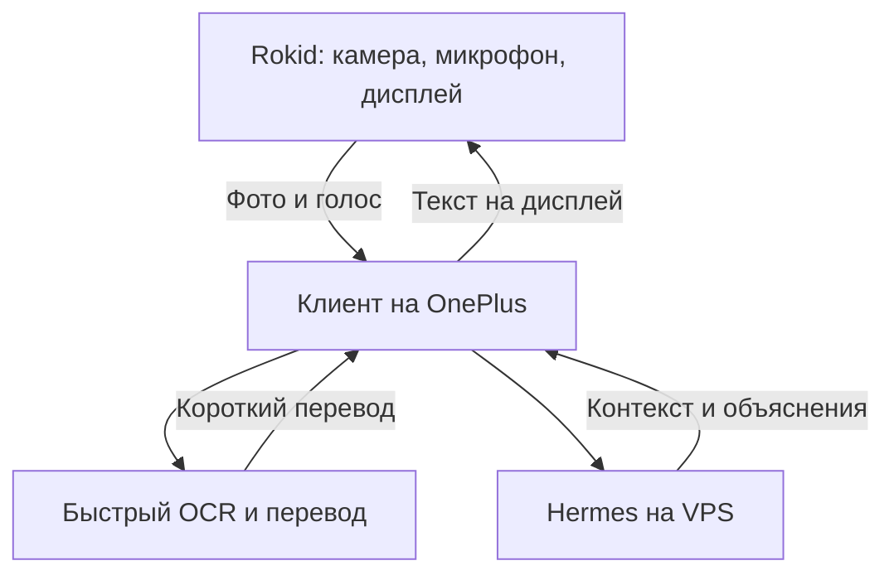

# Приложенный пользователем прежний технический обзор

Уровень: HISTORICAL_REVIEW. Дата импорта в план: 2026-10-23.
Это материал пользователя из `Pasted text(8).txt`, а не новый отчёт о выполненных здесь сборках/тестах.
Фразы «проверил», «скачал», «нашёл» ниже относятся к автору прежнего обзора.
Ссылки `sandbox:` прежней сессии удалены как недоступные; остальное содержание сохранено.
Проверенные заново ограничения и новые проектные решения — в ../SOURCES.md и спецификациях.

---

Я бы взял этот проект за основу твоего клиента для Rokid, а Hermes оставил на VPS. Для экспериментов с текстом и фотографиями он уже достаточно развит. Как готовую замену штатному приложению для постоянного голосового общения и видео я бы его пока не считал надёжным: в ключевых сценариях есть конкретные недоделки.

Репозиторий скачал, проверил код телефона и очков, протокол связи, интеграции моделей, историю релизов и CI. Анализ относится к `main`, коммиту `770bc8d` от 9 октября 2026 года. Готовый релиз на GitHub — `v1.1.0` от 8 августа; между ним и проверенным `main` уже 123 коммита. Поэтому скачанный APK и возможности текущих исходников нужно различать. [GitHub](https://github.com/zero2005x/RokidAIAssistant/releases?utm_source=chatgpt.com)

## Что он умеет применительно к твоим задачам

| Твоя задача | Что есть сейчас | Моя оценка |
|---|---|---|
| Выбирать свои модели и провайдеров | Несколько провайдеров, собственные ключи, Custom OpenAI-compatible endpoint | Подходит |
| Отправлять текст на дисплей очков | Вывод текста, разбиение ответа на страницы, настройка шрифта и области отображения | Одна из наиболее готовых частей |
| Фотографировать с очков и анализировать изображение | Camera2 → Bluetooth → телефон → vision-модель → ответ на очках | Есть код и описанный автором успешный аппаратный тест |
| Показывать ответ постепенно, по мере генерации | Сетевые адаптеры умеют SSE, но обычный пользовательский сценарий ждёт целый ответ | Нужна доработка |
| Передавать изображение с камеры непрерывно | Есть экспериментальная последовательность JPEG-кадров для Gemini Live | Ограниченно; подробности ниже |
| Получать плавное видео для произвольного backend | Готового универсального видеоканала нет | Нужен другой видеотракт |
| Подключить Hermes на VPS | Базовый запрос можно согласовать через Custom endpoint | Перспективно; сессии и контекст требуют доработки |
| Использовать установленный ChatGPT на телефоне | Интеграции с приложением ChatGPT нет | Само наличие ChatGPT на телефоне ничего не подключит |
| Работать весь день без присмотра | Есть фоновые сервисы и восстановление связи, но голосовой/Live-контур недостаточно проверен | Пока не подтверждено |

Это вывод по реализации, а не только по README. Причём README местами расходится с кодом: например, исключает видеостриминг из области проекта, хотя экспериментальная передача кадров уже присутствует. GlassesViewModel.ktИсходники очковой части [локальный файл прежнего сеанса; в этом пакете недоступен].

## 1. Насколько проект вообще зрелый

У него есть существенная инженерная база:

- Раздельные приложения для телефона и очков, общая библиотека протокола.
- Хранение разговоров в Room с миграциями.
- Настройки и ключи в зашифрованном хранилище Android Keystore.
- Передача фотографий частями с подтверждениями, повторными отправками и проверкой целостности.
- Тесты провайдеров, протокола, Bluetooth, камеры, настроек и жизненного цикла.
- CI, выполняющий сборку, тесты и проверку отчётов покрытия.

Для проверенного коммита GitHub показывает успешный [запуск CI](https://github.com/zero2005x/RokidAIAssistant/actions/runs/37872925436). Я проверил его статус через GitHub API и сам sonar.ymlworkflow [локальный файл прежнего сеанса; в этом пакете недоступен].

Но наиболее полезное свидетельство — собственный DEVICE_SMOKE_TEST.mdжурнал аппаратных проверок автора [локальный файл прежнего сеанса; в этом пакете недоступен]. В записи от 1 октября указано, что:

- фотография действительно пришла с очков на телефон по Bluetooth SPP;
- Gemini успешно её проанализировал;
- на очках появились четыре страницы ответа;
- настройка шрифта и области дисплея работала;
- переподключение устройств прошло успешно.

В той же записи прямо сказано, что голосовой ввод, STT, TTS, Gemini Live, остальные провайдеры и ряд других сценариев ещё не проверены на устройстве.

То есть оценка «текст и фото уже можно пробовать» имеет основание. Оценка «полноценный ежедневный голосовой помощник готов» — пока нет.

### Установка на твои очки

Потребуется отдельное приложение на самих очках. Установить только телефонный APK недостаточно. Инструкция проекта предполагает Android-очки с возможностью установки APK, обычно через ADB. [GitHub](https://github.com/zero2005x/RokidAIAssistant/blob/main/glasses-setup.md?utm_source=chatgpt.com)

В текущем коде основной путь для companion-приложения — Camera2 на очках и Bluetooth SPP. Когда телефон узнаёт, что очки используют этот путь, он отключает альтернативное CXR-подключение. Поэтому утверждение «обязательно нужен секрет разработчика Rokid, иначе ничего не заработает» было бы слишком категоричным.

Однако доступность установки APK и камеры именно на твоём китайском экземпляре и его прошивке этот репозиторий подтвердить не может. Это первый практический вопрос перед дальнейшей разработкой.

## 2. Видео: есть важное «частично»

В коде действительно реализована такая цепочка:

1. На телефоне запускается Gemini Live.
2. Телефон отправляет очкам `LIVE_SESSION_START`.
3. Очки начинают повторять обычное фотографирование.
4. Каждое изображение уменьшается, сжимается в JPEG и отправляется как `VIDEO_FRAME`.
5. Телефон пересылает его в Gemini Live.

Но это последовательность отдельных снимков с довольно большой задержкой.

### Что именно ограничивает её

В GlassesViewModel.ktцикле передачи кадров [локальный файл прежнего сеанса; в этом пакете недоступен] стоят параметры:

| Параметр | Значение |
|---|---|
| Размер изображения | Вписывается в 640 × 480 с сохранением пропорций |
| JPEG quality | 50 |
| Пауза после обработки кадра | 1 секунда |
| Передача | Bluetooth SPP, изображение внутри сообщения |
| Получатель | Gemini Live |

Комментарий в коде обещает примерно один кадр в секунду. Но при проверке вызываемой функции выясняется, что каждый снимок дополнительно включает:

- 500 мс ожидания перед доступом к камере;
- открытие камеры и создание сессии;
- 1500 мс стабилизации экспозиции/фокуса;
- съёмку и закрытие камеры.

Получается, в обычном успешном пути уже заложено около трёх секунд на итерацию, ещё до учёта части обработки и передачи. Это расчёт по GlassesCameraManager.ktкоду камеры [локальный файл прежнего сеанса; в этом пакете недоступен], а не измеренный мной FPS.

Поэтому для твоего вопроса ответ такой:

- Передавать периодические изображения с очков — заготовка есть.
- Получать плавный видеопоток — этот механизм не подходит.
- Отправлять такой поток в Hermes или произвольную модель — готового подключения нет.
- Для чтения мелких музейных надписей уменьшение до такого разрешения выглядит неудачным выбором. Я бы делал отдельный режим качественного снимка для OCR.

### Нашёл подходящий источник кода для полноценного видео

Дополнительно скачал и проверил [Rokid Live Studio](https://github.com/Anezium/Rokid-Live-Studio). Там в исходниках есть настоящий тракт:

`Camera2 → аппаратный H.264 → Wi‑Fi Direct/TCP → телефон`

Также реализованы захват микрофона и AAC. Это полезный кандидат для заимствования видеомодуля: камера работает непрерывно, присутствуют кодер, бинарный протокол, приёмник и декодер на телефоне.

Но есть два существенных ограничения:

- Подключение жёстко ориентировано на Global Hi Rokid, вплоть до имени Android-пакета `com.rokid.sprite.global.aiapp`. Совместимость с твоим китайским приложением нужно проверять отдельно.
- Автор предупреждает о сильном нагреве и быстром расходе батареи при длительном стриминге. Независимых замеров я не делал. [GitHub](https://github.com/Anezium/Rokid-Live-Studio?utm_source=chatgpt.com)

Проверенные файлы: CameraH264Streamer.ktCameraH264Streamer.kt [локальный файл прежнего сеанса; в этом пакете недоступен], CxrPhoneController.ktCxrPhoneController.kt [локальный файл прежнего сеанса; в этом пакете недоступен].

Я рассматриваю его как источник видеокода. Готового AI-помощника для твоего сценария он не заменяет.

## 3. Вывод текста на очки — да; потоковый ответ — пока нет

Обычный вывод реализован достаточно содержательно:

- отдельные сообщения для текста и статуса;
- очистка Markdown;
- разбиение длинного ответа на страницы;
- управление страницами;
- настройка шрифта, размера и области экрана;
- повторная синхронизация настроек после подключения.

Это стоит сохранить в своём проекте.

Но обычный текстовый или голосовой запрос сейчас проходит так:

> Получить запрос → дождаться полного ответа модели → отправить весь ответ на очки.

В `OpenAiCompatibleService` есть настоящий SSE-клиент, однако основной сценарий вызывает обычный `chat()`, причём запрос явно формируется с `stream=false`. Это видно в ConversationViewModel.ktConversationViewModel [локальный файл прежнего сеанса; в этом пакете недоступен] и OpenAiCompatibleService.ktOpenAiCompatibleService [локальный файл прежнего сеанса; в этом пакете недоступен].

Автор сам вынес передачу текстовых дельт и их отображение на очках в открытые задачи. То есть это запланированная работа, а не уже готовая функция. [GitHub](https://github.com/zero2005x/RokidAIAssistant/issues/36?utm_source=chatgpt.com)

У Gemini Live есть отдельная передача промежуточных транскрипций, но очки обрабатывают каждую как новый полный ответ и возвращаются на первую страницу. Для аккуратного чтения постепенно поступающего текста эту часть тоже нужно привести в порядок.

Для твоего быстрого переводчика я бы считал сквозной стриминг текста одной из первых доработок.

## 4. Hermes: хороший вариант, причём базовое подключение довольно близко

У актуального Hermes уже есть встроенный HTTP API для внешних клиентов, включая OpenAI-compatible интерфейс и SSE. Необязательно писать ещё один сервер только ради того, чтобы принять запрос с телефона. [Hermes Agent](https://hermes-agent.nousresearch.com/docs/developer-guide/programmatic-integration?utm_source=chatgpt.com)

Начальная конфигурация RokidAIAssistant могла бы выглядеть так:

| Настройка | Значение |
|---|---|
| Provider | `Custom` |
| Protocol | `Chat Completions` |
| Base URL | `https://твой-сервер/v1/` |
| API key | Ключ API-сервера Hermes |
| Model | `hermes-agent` либо имя профиля |
| Vision | Включить вручную для Custom, если backend поддерживает изображения |

На стороне Hermes сервер включается через `API_SERVER_ENABLED=true`, `API_SERVER_KEY` и запуск `hermes gateway`. По умолчанию он слушает `127.0.0.1:8642`; телефону нужен доступный защищённый адрес. API принимает и изображения через `image_url`, включая data URI. [Hermes Agent](https://hermes-agent.nousresearch.com/docs/user-guide/features/api-server?utm_source=chatgpt.com)

Это согласование интерфейсов по коду и документации. На твоём VPS я его не проверял, поэтому обещать подключение без единой настройки было бы неправильно.

### Почему одного Custom endpoint недостаточно для хорошего постоянного клиента

Нашёл конкретную проблему с идентичностью диалога:

- клиент передаёт только шесть предыдущих сообщений;
- добавляет в системный промпт текущее время с точностью до минуты;
- не передаёт `X-Hermes-Session-Id` и другие специфические идентификаторы Hermes.

А Hermes при отсутствии явной сессии выводит её идентификатор из системного промпта и первого пользовательского сообщения. Следовательно, изменение времени или сдвиг окна истории может создавать новую серверную сессию, хотя для тебя разговор продолжается. Это вывод из сопоставления реализаций, а не воспроизведённый аппаратный баг. [Hermes Agent](https://hermes-agent.nousresearch.com/docs/user-guide/features/api-server?utm_source=chatgpt.com)

Со стороны клиента это видно в BaseAiService.ktBaseAiService.kt [локальный файл прежнего сеанса; в этом пакете недоступен] и упомянутом `OpenAiCompatibleService`.

Я бы добавил небольшой отдельный адаптер Hermes, отвечающий за:

- стабильную серверную сессию и область памяти;
- потоковый текст;
- статус работы инструментов;
- отмену длительного запроса;
- восстановление результата после обрыва связи;
- идентификатор запроса, чтобы повторная отправка не запускала действие заново.

### Фотографии сейчас не становятся контекстом разговора

Это особенно существенно для твоего музейного сценария.

В нынешнем коде фотография автоматически анализируется с заранее заданным промптом. Ответ показывается на очках, а фото хранится отдельно. В vision-запросе Custom/OpenAI нет предыдущей истории разговора.

Поэтому сценарий:

> «Посмотри на экспонат. Теперь объясни, чем он отличается от предыдущего».

не обеспечивается одним фактом наличия галереи.

Нужно явно помещать снимок, распознанный текст и результат анализа в ту же сессию Hermes. Сейчас такой связи нет. PhoneAIService.ktКод обработки фотографий [локальный файл прежнего сеанса; в этом пакете недоступен].

И ещё: выбор Hermes как AI backend сам по себе не подключает распознавание речи. STT остаётся отдельным компонентом.

## 5. Что получится с ChatGPT на телефоне

Здесь важно разделить три варианта.

### Установленное Android-приложение ChatGPT

Готового подключения к нему в проекте нет. Я также не нашёл документированного Android-интерфейса для сценария «постоянно подавать изображения в установленный ChatGPT и забирать его потоковый ответ в другое приложение».

Поэтому я бы не строил архитектуру вокруг управления экраном ChatGPT или перехвата его интерфейса. Стабильной основой для такого клиента это не выглядит.

### OpenAI API

Этот путь уже предусмотрен проектом: собственный ключ, выбор модели, текстовые и vision-запросы. Устанавливать приложение ChatGPT для этого не требуется.

Обычный API имеет отдельный биллинг от подписки ChatGPT. А полноценный OpenAI Realtime-контур для очков пришлось бы реализовать отдельно: наличие провайдера OpenAI в настройках не означает готовый голосовой/видеоклиент. [OpenAI Help Center](https://help.openai.com/en/articles/9039756-managing-billing-for-chatgpt-and-the-api-platform?utm_source=chatgpt.com)

### Использование подписки через Sign in with ChatGPT

Есть актуальный дополнительный вариант: официальная документация теперь описывает Sign in with ChatGPT для open-source клиентов с разрешением использовать подходящий план ChatGPT для AI-запросов.

Но для RokidAIAssistant это отдельная доработка OAuth и обработки Responses API. Такого входа в текущем коде нет. Доступ к истории разговоров и памяти твоего ChatGPT этот механизм автоматически не даёт; доступность зависит от аккаунта и условий интеграции. [OpenAI Developers](https://developers.openai.com/siwc/token-sharing-open-source?utm_source=chatgpt.com)

У Hermes также документирован вариант провайдера `ChatGPT or Codex Subscription`. Поэтому если цель — использовать подписку, я бы сначала проверил этот путь на стороне Hermes, сохраняя телефонный клиент независимым от способа авторизации модели. [Hermes Agent](https://hermes-agent.nousresearch.com/docs/integrations/providers?utm_source=chatgpt.com)

## 6. Какие недоделки мешают постоянному использованию

Помимо видео, стриминга текста и контекста, выделю четыре.

### «Wake word» фактически реагирует на громкость

Класс `WakeWordService` не распознаёт конкретную фразу. Он измеряет амплитуду микрофона и срабатывает после примерно 500 мс громкого звука.

В шумной обстановке это создаёт риск ложных активаций. Для первого рабочего варианта я бы использовал кнопку, а затем добавлял настоящее распознавание ключевой фразы. WakeWordService.ktРеализация [локальный файл прежнего сеанса; в этом пакете недоступен].

### В Gemini Live не завершён путь звука с очков

Очковое приложение собирает звук и отправляет его по окончании записи. Телефон в активном Live-режиме этот массив не отправляет в модель: код предполагает, что звук уже передавался в реальном времени.

При этом фактически Live использует телефонный `AudioRecord`. Возможная маршрутизация Bluetooth-аудио средствами Android — отдельный вопрос, но код не гарантирует, что модель слышит именно микрофон очков.

Поэтому демонстрация «Live работает на телефоне» ещё не доказывает работоспособность режима «телефон в кармане, разговариваю через очки». PhoneAIService.ktОбработка голосовых сообщений [локальный файл прежнего сеанса; в этом пакете недоступен].

### Переподключение есть, надёжной доставки результата пока нет

Телефонный foreground service и восстановление Bluetooth реализованы. Но если ответ готов в момент отсутствия соединения, отправка может вернуть `false`; полноценной очереди с последующей доставкой результата я не нашёл.

Также команда запуска Live-камеры отправляется при создании Live-сессии и не повторяется в обычном обработчике нового Bluetooth-подключения. Это вероятная проблема порядка запуска и восстановления связи.

Для Hermes, который может работать над запросом дольше обычной модели, эти случаи важнее, чем для короткого чат-бота.

### Режим переводчика нужно выделить отдельно

Базовый сервис добавляет жёсткие инструкции отвечать только на языке приложения, не отвечать одним словом и добавлять контекст.

Обычный русский интерфейс от этого не обязательно сломан: настройки языков согласуются. Но твой режим русско-китайского переводчика и краткого OCR-перевода может конфликтовать с такими инструкциями. Я бы задавал язык и краткость на уровне конкретной задачи. BaseAiService.ktФормирование системного промпта [локальный файл прежнего сеанса; в этом пакете недоступен].

## 7. Что именно я бы взял в свой проект

| Компонент | Как использовать |
|---|---|
| Очковый UI и разбиение текста на страницы | Сохранить и добавить потоковое обновление |
| Настройки шрифта и области дисплея | Сохранить |
| Протокол телефона и очков | Сохранить, расширить идентификаторами запросов и текстовыми дельтами |
| Bluetooth SPP | Использовать для команд, текста и первых сценариев с фото |
| Передача фотографий | Использовать как основу |
| Camera2-фотографирование | Взять для MVP, затем оптимизировать задержку |
| Адаптеры моделей и настройки | Переиспользовать нужные |
| Gemini Live-контур | Доработать отдельно |
| `WakeWordService` | Заменить или отключить |
| «Локальная Gemma» | Не считать готовой функцией: runtime-движок в стандартном пути не подключён |
| Полноценное видео | Рассмотреть перенос из Rokid Live Studio после проверки совместимости |

В текущем `main` есть Apache-2.0 и `NOTICE`, что делает исходники удобной базой для заимствования. При переносе нужно сохранить лицензионные уведомления. Проприетарный Rokid CXR SDK является отдельной зависимостью и этой лицензией не покрывается. [GitHub](https://github.com/zero2005x/RokidAIAssistant/blob/main/LICENSE?utm_source=chatgpt.com)

## 8. Как я бы собрал твой вариант

Для твоей идеи «быстрый перевод увиденного плюс агент, который постепенно понимает контекст» я бы сделал два пути обработки:

Быстрый путь должен сначала показать перевод надписи. Фоновый агент получает снимок и текст, связывает их с предыдущими объектами, готовит объяснение и отвечает на вопросы. Тогда простая операция перевода не будет ждать полного агентного цикла с поиском и инструментами.

Порядок работы я бы выбрал такой:

1. Проверить установку companion APK на твоих очках, Bluetooth-связь и вывод русского текста.
2. Проверить качественную фотографию и анализ через Custom endpoint.
3. Подключить Hermes на телефоне, затем добавить устойчивую сессию и визуальный контекст.
4. Провести потоковый текст до дисплея очков.
5. Сделать отдельный режим OCR/перевода.
6. Проверить работу с телефоном в кармане, выключенным экраном, обрывами сети и Bluetooth.
7. После этого заниматься непрерывным видео и голосовой активацией.

По масштабу это выглядит как разумная доработка существующего Android-проекта для текста, фото и Hermes. Надёжный непрерывный аудиовидеорежим — уже отдельная существенная часть работы.

### Границы проведённой проверки

Исходники и публичные результаты CI проверены; файлы проекта я не менял. Локальную сборку попытался запустить, но она остановилась на отсутствии требуемого JDK 21 и невозможности автоматически получить toolchain в этой среде. Поэтому собственную успешную сборку APK я не заявляю. На реальных очках проверки не было; аппаратные результаты выше — из журнала автора.

Моя рекомендация: использовать текущий `main` как основу клиента «Rokid ↔ Android ↔ Hermes», начать с текста и фотографий. Самые ценные части уже написаны — связь с очками, дисплей, фотографирование и настройки. Для твоего сценария основная работа остаётся в скорости ответа, сохранении контекста и надёжном поведении при прерывании связи.
